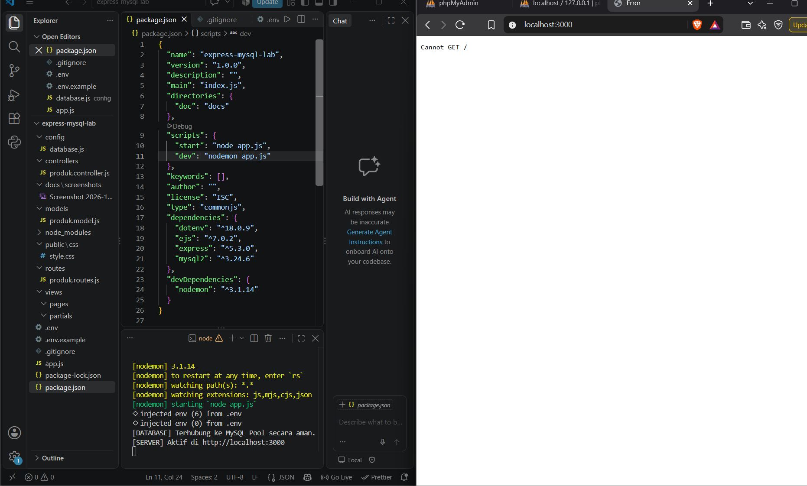
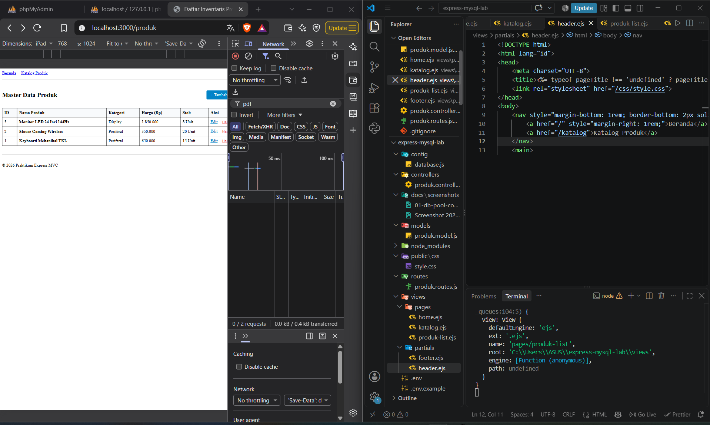
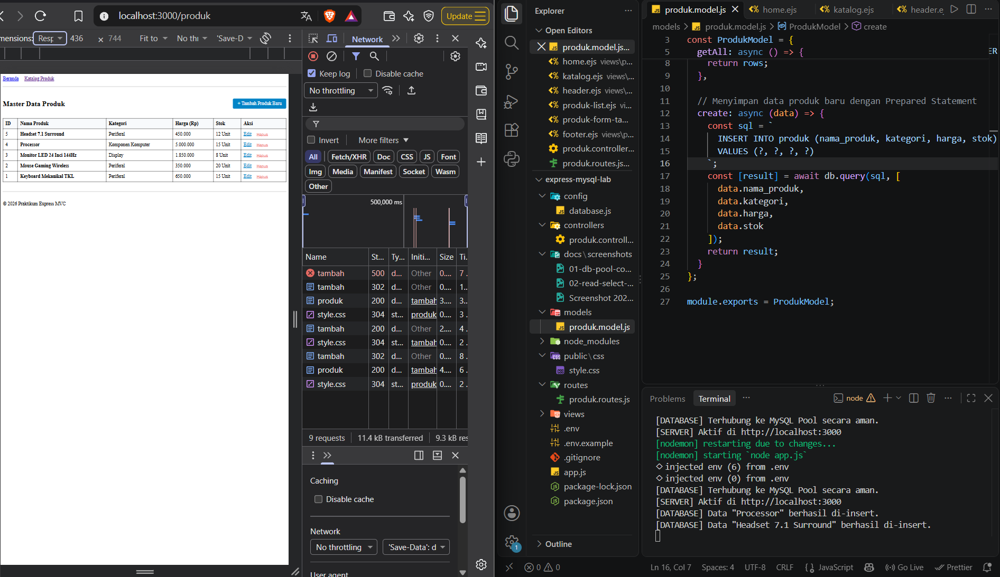
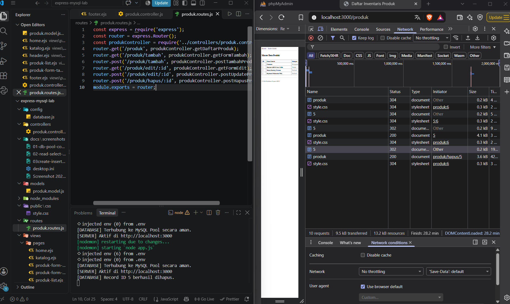
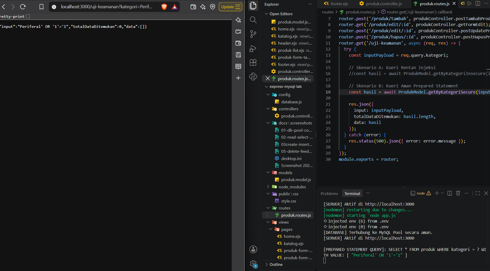
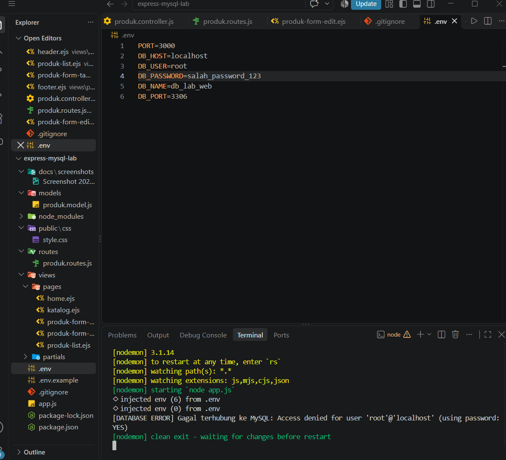
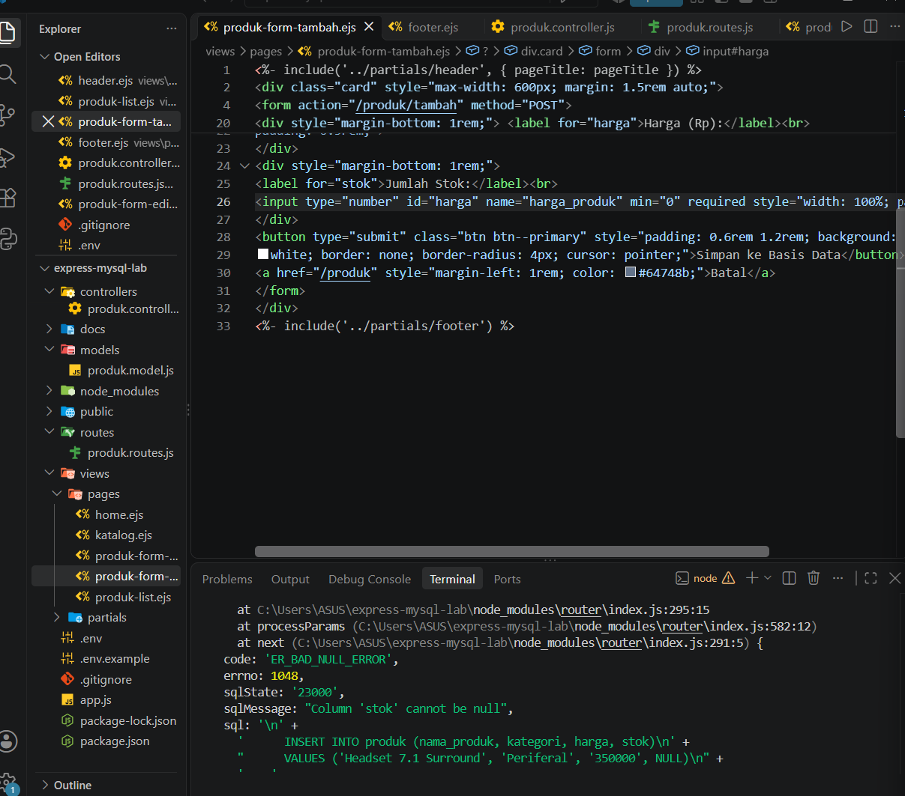

# Express MySQL Lab: CRUD Produk

Aplikasi CRUD produk menggunakan Node.js, Express, EJS, dan MySQL (mysql2/promise) dengan arsitektur MVC.

**Nama:Matthew Friarel Panjaitan** 
**NIM:42530042**
**Mata Kuliah:Pemrograman web**

## Teknologi
- Node.js, Express, EJS
- MySQL (via XAMPP), driver `mysql2` dengan connection pool
- `dotenv` untuk variabel lingkungan, `nodemon` untuk pengembangan

## Struktur Proyek
```
config/       koneksi database (connection pool)
models/       kueri SQL (Model)
controllers/  logika request/response (Controller)
routes/       definisi endpoint
views/        tampilan EJS (pages, partials)
public/       aset statis
docs/screenshots/  bukti pengujian
```

## Cara Menjalankan
1. Jalankan Apache dan MySQL di XAMPP.
2. Buat database dengan menjalankan script SQL (database `db_lab_web`, tabel `produk`).
3. Salin `.env.example` menjadi `.env`, lalu sesuaikan nilainya.
4. Instal dependensi dan jalankan:
   ```bash
   npm install
   npm run dev
   ```
5. Buka `http://localhost:3000/produk`.

## Matriks Penelusuran Pengujian (Traceability Matrix)

| No | Indikator Capaian | Pengalaman | Skenario Uji | Hasil yang Diharapkan | Status | Bukti |
|----|-------------------|------------|--------------|-----------------------|--------|-------|
| 1 | Konfigurasi dotenv, isolasi kredensial `.env`, dan inisialisasi connection pool | Pengalaman 1 | Jalankan server dengan `.env` yang benar | Terminal mencetak "Terhubung ke MySQL Pool" dan server aktif | Lulus |  |
| 2 | Kueri SELECT di Model dan render tabel EJS | Pengalaman 2 | Buka `GET /produk` | Status 200 OK, tabel menampilkan data dari MySQL | Lulus |  |
| 3 | INSERT INTO dan pola Post-Redirect-Get | Pengalaman 3 | Kirim form tambah produk (`POST /produk/tambah`) | 302 Found ke `/produk`, lalu 200 OK; data muncul di tabel; log insert tercetak | Lulus |  |
| 4 | Ekstraksi `req.params.id`, pre-filled form, dan UPDATE | Pengalaman 4 | Buka `GET /produk/edit/:id`, ubah data, kirim | Form terisi data lama; setelah submit 302 ke `/produk` dan data berubah | Lulus |  |
| 5 | DELETE berparameter | Pengalaman 5 | Klik Hapus lalu OK (`POST /produk/hapus/:id`) | 302 Found; record hilang dari tabel dan database; log hapus tercetak | Lulus |  |
| 6 | Prepared Statement dan ketahanan terhadap SQL Injection | Pengalaman 6 | Akses `/uji-keamanan?kategori=Periferal' OR '1'='1` | Versi rentan: seluruh data bocor. Versi aman: `totalDataDitemukan: 0` | Lulus |   |

### Investigasi Masalah (Troubleshooting)

| No | Kasus | Cara Memicu | Gejala | Perbaikan | Bukti |
|----|-------|-------------|--------|-----------|-------|
| T1 | Access Denied | Ubah `DB_PASSWORD` di `.env` menjadi salah | `Access denied for user 'root'@'localhost'`, server tidak menyala | Kembalikan `DB_PASSWORD` yang benar |  |
| T2 | Bind parameters undefined | Ubah `name="harga"` menjadi `harga_produk` di form | `Bind parameters must not contain undefined` | Samakan atribut `name` form dengan variabel di controller |  |
| T3 | Pool exhaustion | `connectionLimit: 1` dan koneksi tidak di-release | Request pending terus, aplikasi tidak merespons | Kembalikan limit 10 dan `release()` di `finally` |  |

## Analisis Singkat
- **PRG (Post-Redirect-Get):** setelah POST, server membalas 302 dan browser memuat ulang lewat GET, sehingga refresh tidak mengirim data dua kali.
- **Prepared Statement:** placeholder `?` memisahkan struktur SQL dari data, sehingga input berbahaya diperlakukan sebagai teks biasa.
- **Connection Pool:** koneksi dipakai ulang dan dilepas otomatis lewat `db.query()`. Pemakaian `getConnection()` manual wajib diakhiri `release()`.

## Catatan Keamanan
File `.env` tidak diunggah ke repositori. Gunakan `.env.example` sebagai acuan.
